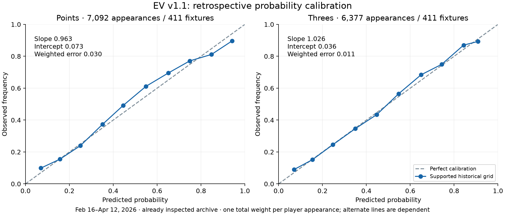
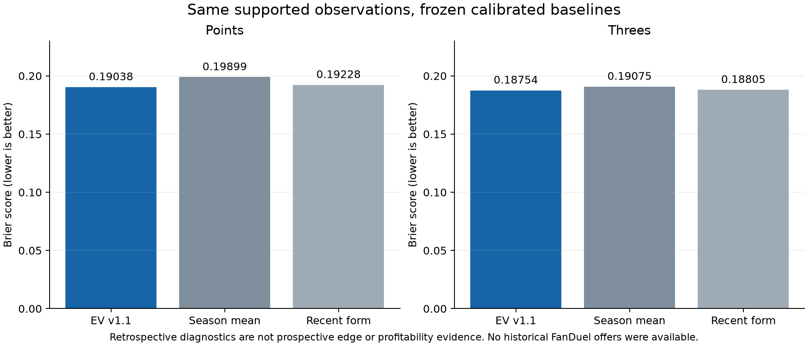

# NBA Parlay Machine and EV Bets audit — October 19, 2026

**Decision: suitable for data exploration and supervised research testing; insufficient evidence for a dependable public positive-EV product or a demonstrated predictive/profitable advantage.** The historical final-box database reconciles to the downloaded official NBA PDFs. Price matching and EV arithmetic passed the checks below. The largest unresolved risks are forecasts of next-season minutes/role, extreme-count probabilities, and the absence of a trusted shared forecast issuer. Correct source statistics do not validate future probabilities.

This audit examined the repository and deployed application, collectors, immutable odds snapshots, downloaded gamebooks/SQLite, frozen model, browser records, refresh workflows and grading. It implements confirmed correctness fixes as **ev-props-v1.1**, preserving the original v1 engine/model/protocol/UI under [baseline](baseline/). The Parlay weights, target definitions and frozen Parlay research protocol were not changed. The archive was already inspected and corrected before this audit; every historical result here remains **retrospective**.

## What the numbers mean

| Display / quantity | Meaning and permitted interpretation |
|---|---|
| Season PPG / 3PM / shooting percentages | Observed statistics in the labeled competition, season and team stint. Percentages use summed makes divided by summed attempts; averages use actual appearances. These are not chances of clearing a bet. |
| First-score share / when starting | Descriptive counts divided by team games / actual starts respectively. The denominators are different and are displayed. |
| Historical first-score grade | Sample-adjusted starting rate, capped by observed team scoring share. Its percentage-shaped score is not a validated matchup win probability. |
| Original Parlay grade | Equal-weight descriptive ranking of player evidence, own positional production and opponent positional allowance, subject to eligibility. It is not the EV engine. |
| Parlay Points / Threes target | Candidate-specific, frozen production-basis season average. This is not an offered sportsbook line or a forecast distribution. |
| EV expected production | Calibrated distribution mean; raw shooting-derived mean is separately exposed in projection details. |
| EV model win / push | Estimated exact-contract probabilities, conditional on participation and ordinary settlement. No unconditional availability/void probability is fitted. |
| Book break-even | `1 / decimal odds`, to compare with model win probability conditional on a decisive outcome when pushes are possible. A price does not reveal an independently known true probability. |
| Conditional EV | Expected profit per $1 of action: `P(win) × (decimal − 1) − P(loss)`. Refunded outcomes contribute zero profit. Model error directly becomes EV error. |

| Market | Present support | Unsupported claims |
|---|---|---|
| First Team Basket / first made field goal | PDF opening-event evidence, selectable scoring definition, confirmed-starter gate for finalized upcoming picks; broad G/F/C fallback and strict-five-position choice in Parlay | No First Team Basket EV model; no calibrated claim from the historical grade |
| Points | Parlay season-average rankings; separate experimental regular-season full-game count probability/EV model at supported exact offered lines | Reliable live role transfer, postseason EV, combos/PRA |
| Made Threes | Separate full-game count model, supported milestones/half/integer lines | First three, team totals, unsupported tails, postseason EV |
| First Basket across both teams | Historical scoring-definition option and research context | No validated First Basket EV or game-opening possession model |
| Combined parlays | Individual selections can be inspected | No joint probability or combined EV; individual probabilities must not be multiplied as an independence assumption |

## Source-to-outcome evidence

**Completed-game authority:** original NBA gamebook final boxes, with source URL and SHA-256 retained. [source-reconciliation.json](source-reconciliation.json) records fresh first-page extraction for **all 1,322 PDFs**, **28,716 played player rows**, and **1,952,688 field comparisons** against the app ledgers and read-only library SQLite: **zero differences**, database integrity `ok`. Coverage is 1,230 regular season, 85 playoffs, six play-in and one Cup final. Seventeen compared fields cover precise minutes, all shooting totals, points, rebounds, assists, steals, blocks, turnovers, fouls and plus/minus. The parser uses the project's documented identity crosswalk; common parser/crosswalk errors cannot be ruled out merely by repeated agreement. A rendered original final box was also inspected, including Nick Richards' printed 00:00 appearance.

[season-totals.json](season-totals.json) independently reconciles SQL aggregates, 582 canonical players, 2,328 phase GP/PPG checks, and **34,998 full-stat aggregate comparisons across 921 player-phase groups**. TS% uses points and total FGA/FTA. Regular season, playoffs, play-in and Cup remain separate; selecting all competitions explicitly changes the denominator. Team stints remain distinct. DNP is not a zero-point appearance, while a printed 00:00 played row is an appearance. Missing or unsupported fields withhold forecasts rather than becoming zero.

[opening-reconciliation.json](opening-reconciliation.json) replays all 1,322 hash-linked Q1 extractions and freshly extracts 12 deterministic original-PDF samples. All **5,288 first-score/first-field-goal references** agree. Free throws and and-one context remain distinguishable in the opening data. This is not a fresh extraction of every play from every full game. Defender identity, possessions, lineup on/off effects and schemes are not structured or established by this evidence.

**Current identity:** the FanDuel quote replay independently fetched ESPN rosters for the quoted teams and matched canonical IDs. [price-replay.json](price-replay.json) retains these source URLs/times. Present rosters are used for current eligibility, not to rewrite historical stints/positions. Prior-season and prior-team context remain labeled; EV requires 20 prior appearances with the current team and does not borrow another team's production to meet that minimum.

**Representative trace:** [offer-traces.json](offer-traces.json) links the largest captured opener discrepancies to exact FanDuel event/market/selection IDs, quote time, calibrated/raw means, dispersion, minutes/attempts/conversion, empirical exact-line wins/losses, and recent original PDF URLs/hashes. The source envelopes are [live-market-evidence.json](live-market-evidence.json); the normalized 16-fixture / 2,037-quote snapshot is [live-price-snapshot.json](live-price-snapshot.json), captured at **2026-10-19 05:21:50 UTC**. These retained prices are historical audit evidence, not a current offer. All 2,037 normalized quotes replayed without a difference. Six unposted-tab issues across three later fixtures are visible availability gaps, not fabricated prices. There are 265 complete matching two-way pairs across that snapshot; the three-opener model trace contains 74 pairs, 340 data-supported offers and 207 withheld offers. The data-only trace does not reconstruct missing live availability gates.

**Largest discrepancy:** Keldon Johnson 20+ Points at +1800 had an estimated win chance **24.21%** and conditional EV **+359.91%**. Identity, milestone, odds conversion and source fields reconcile. His descriptive prior sample hit 13/82 (15.85%), which itself is not a future forecast. The model assumes **23.50 minutes**. In a controlled sensitivity calculation, half those minutes gives win probability 1.76% and EV **−66.49%**. This is evidence of sensitivity, not a claim his actual minutes should halve. VJ Edgecombe 25+ and Joel Embiid 35+ similarly retain large model-market differences after matching checks. We found no demonstrated pricing error that makes those edges real. Rotation transfer and distribution tails remain plausible model-error sources; actual upcoming roles are unresolved. No arbitrary EV cap or market blend was added to conceal the discrepancy.

When a final PDF arrives, the new research grader joins the frozen fixture/player/exact threshold, verifies the PDF hash, full-game minutes and box reconciliation, and produces a separate versioned result report. No source means pending; contradictions mean review. It does not rewrite the forecast or declare an actual sportsbook settlement.

## Basketball and probability assessment

The shooting model builds Points from separate expected two-point makes, three-point makes and free-throw makes. Threes uses expected 3PA × conversion. Minutes and attempts use recent 20-appearance weighting with shrinkage toward same-team history; conversion and dispersion are estimated from prior evidence. This is a reasonable research baseline, but not a coach-verified next-game rotation. It has no validated pace forecast, possession-level matchup, teammate-absence redistribution, lineup synergy or defender assignment. Projected starter/bench role changes are withheld; unconfirmed context stays provisional. Eligible bench players can enter Points/Threes. Out/Doubtful remain excluded; Questionable remains provisional. Finalized First Team Basket still requires confirmed starters. A single player can independently lead all three rankings.

G/F/C allowance uses scoring per player-minute and shrunken comparisons with a league role baseline, reducing simple minutes/exposure bias. It is still a roster-role proxy: pace, opponent quality, lineup context, usage and role mixtures can confound it. Broad roles are explicitly labeled; uncertain five-position assignments are not invented. Adding a pace/possession or defender-specific claim would require new verified inputs and a separate evaluation.

FGA/FGM and 3PA/3PM correlation is an existing operational eligibility filter. Makes are mechanically part of attempts; a positive correlation is not independent evidence of predictive value. The chronological comparisons below test the richer shooting features against simpler production-history forecasts. The chosen Points model uses an opponent-rate exponent of 0.5; setting it to zero and recalibrating changes supported Brier from **0.19038 to 0.19080**, a small exploratory effect. Threes selected zero positional exponents; forcing a multiplier is unsupported. The original Parlay weighting remains a descriptive ranking, not validated because the separate EV model performs differently.

Each market fits a negative-binomial count distribution, with calibrated increasing CDF. Exact offered thresholds derive win/loss/push probabilities from that CDF. Distribution normalization, means, finite prices, monotone alternate-line probabilities and milestone/half-line equivalence are regression-tested. Marginal Points means remain at least three times marginal Threes means in the replayed paired forecasts; a joint score distribution is not modeled. Thresholds require at least five historical wins and five losses and remain inside the calibration grid. Those filters do not make five tail observations reliable. The supported over-6.5-Threes stratum has only 69 appearances and poor exploratory calibration (slope about 0.37, intercept about −1.48); it is inconclusive and not release evidence for extreme lines.

## Retrospective validation

Development ends December 15, 2025; calibration is December 16–February 15; diagnostic dates are February 16–April 12, 2026. All forecasts for a date are made before any outcome from that date is added. Baseline choices/calibration use development/calibration only. Diagnostic calibration slope/intercept are descriptive audit fits, never applied back to the production model. Historical pregame injuries, announcements and sportsbook prices are absent, so those conditions cannot be reconstructed from final boxes. The same inspected season cannot become an untouched test after a code change.

[model-diagnostics.json](model-diagnostics.json) retains raw and calibrated season-mean baselines, a calibrated recent-form baseline, a position-feature ablation, coverage, calibration bins and performance by probability band, line range, G/F/C and historical starter/bench role, and 20–39/40–59/60+ history. One total weight per player appearance prevents extra alternate lines from inflating that appearance's weight. Fixture bootstrap intervals keep both teams, players and thresholds together; 1,000 replicates use fixed seed 642019. Eight weekly blocks provide a short-period sensitivity check, not proof of independence across repeated players or long-run stability.

| Supported historical grid | Points | Made Threes |
|---|---:|---:|
| Distinct player appearances / fixtures | 7,092 / 411 | 6,377 / 411 |
| Threshold observations (dependent) | 27,529 | 19,215 |
| Brier, EV v1.1 | **0.19038** | **0.18754** |
| Brier, calibrated season mean | 0.19899 | 0.19075 |
| Brier, calibrated recent form | 0.19228 | 0.18805 |
| Log loss, EV v1.1 | 0.56411 | 0.55658 |
| Calibration intercept / slope | 0.073 / 0.963 | 0.036 / 1.026 |
| Weighted ten-bin calibration error | 0.02956 | 0.01061 |
| Brier loss difference vs recent, fixture 95% interval | [−0.002489, −0.001288] | [−0.001079, +0.000016] |

Lower losses are better. Points shows a retrospective improvement over both simple baselines. Threes' Brier advantage over recent form is uncertain, although its log-loss comparison favors the model. Neither comparison establishes an advantage over a sportsbook. The full-grid Brier scores, 0.16647 / 0.09079, include a different threshold mix and many easier outcomes. They must not headline the supported-offer-like sample or imply the support filters improve accuracy. The UI now emphasizes the supported results and explains this distinction. Positive/nonpositive-correlation strata and supported/full coverage are reported; changes in evaluated samples are not causal filter benefits.

Minutes forecast MAE is about **4.8 minutes** when postgame starter/bench role matches the historical role, versus **7.7 minutes** when it changes. Actual role is used only to diagnose error. The model cannot know it beforehand without a reliable pregame feed. Early-season transfer and injury-driven changes need prospective testing, not a confidence label inferred from historical aggregate calibration.

## Findings, corrections and verification

Severity: **P1** blocks trustworthy commercial EV / track-record claims; **P2** is a correctness or misleading-presentation defect; **P3** is a reliability or evidence limitation. “Open” describes an explicit release requirement, not a silently accepted claim.

| ID / severity / status | Evidence and component | Practical consequence | Correction / recommendation | Verification |
|---|---|---|---|---|
| A01 P2 fixed | `validRow` excluded three official played 00:00 rows; final PDFs / EV engine | Wrong participation denominators and zero outcomes | v1.1 retains played rows, still excludes DNP; no positive exposure withholds | Full PDF replay; zero-minute regression; rebuilt model |
| A02 P2 fixed | UI showed raw mean beside calibrated probabilities | Expected count and displayed probability described different distributions | Expose calibrated mean, retain labeled raw mean and dispersion | CDF mean regression and browser projection details |
| A03 P2 fixed | Snapshot fixture comparisons lacked date/season/phase/tipoff checks | Changed or mismatched fixture could pass team checks | Exact identity plus regular-season / finite-price guards | Wrong-date/phase/season/tipoff and price regressions |
| A04 P2 fixed | Threshold type/name conflict and quarter lines insufficiently rejected | Wrong settlement/probability | Require milestone name/type agreement; integer or half-count lines only | Collector/model contradictory-name and quarter-line tests |
| A05 P2 fixed | Retry-After parser handled seconds but not HTTP dates | A source backoff could be ignored | Honor HTTP dates, bound short waits, defer long waits | Short-date retry / long-date deferral tests |
| A06 P2 fixed | Historical diagnostics emphasized full-grid loss | Easy thresholds could overstate useful calibration | Prominent supported-grid results, same-sample baselines, strata and intervals | Diagnostic JSON, plots and UI tests |
| A07 P2 fixed | Saved records did not preserve display policy / exact displayed IDs | Cannot reconstruct what user saw or filter changes | Schema 2 includes both; full positive/negative universe retained; source commit gate | Archive dedup / UI export tests and real download |
| A08 P1 corrected research path | EV records lacked a final-outcome grading flow | Predictions could not be reproducibly compared with final PDFs | Add separate, versioned conservative grader; verify full-game evidence; preserve records | Exact milestone/half/integer/DNP/zero-minute/pending/conflict tests |
| A09 P2 fixed labeling | Verified local Parlay journal notice could imply EV records were server-verified | Misleading strength of evidence | Distinguish Parlay journal and browser-local EV records | Global notice / EV export verification |
| A10 P1 open | Extreme milestone differences persist after 2,037-quote replay; offer traces | A correct price join can still produce false massive EV | Validate role/minutes transfer and tails prospectively; publish research status only; no EV cap | Prespecified prospective cohort and extreme-line strata |
| A11 P1 open | Browser-only IndexedDB; no independent fixture/checkpoint issuer | Editable records and selective collection cannot prove issuance or coverage | Shared append-only issuer, externally witnessed pre-tip receipts, independent expected-fixture ledger | Receipt integrity, omission/coverage and restart/failure tests before formal cohort |
| A12 P1 open | No archived historical pregame FanDuel prices | No defensible historical ROI, market advantage or closing-line claim | Preserve future exact offers and comparable pairs; separate paper returns and actual execution | Forward protocol, same-contract benchmarks and settlement audit |
| A13 P1 open | Prior-season minutes; stable-role MAE 4.8 vs changed-role 7.7 | Early-season projections can be materially wrong despite accurate totals | Reliable pregame role context; abstain on supported role conflict; validate transfer by cohort | Opening-ten-team-game / availability strata; sensitivity traces |
| A14 P2 open | Over-6.5 Threes supported stratum n=69, poor slope/intercept | Global calibration hides sparse tail weakness | Treat as inconclusive; require declared stratum support/calibration before a production claim | Prospective line/probability bands; no arbitrary cap |
| A15 P3 limited | G/F/C scoring per minute, no defender/possession tracking | Positional signal can conflate pace, role and player ability | Retain proxy labels / strict-five option; no defender assignments; test added value | No-position ablation and prospective same-sample losses |
| A16 P3 passed scope | Full final-box / season / Q1 audits, zero differences | Strong source consistency, not proof of all semantic extraction | Preserve URLs/hashes/identity rationale; extend visual and full-PbP audits as needed | 1,322 fresh final boxes; 12 fresh Q1 samples; SQL totals |
| A17 P3 passed guards | Player-specific date cutoffs; same-date block update; current-team-only EV | Prevents selected-game/future outcomes and new-team history leakage | Keep strict cutoff and explicit prior history; do not inject final starters into historical forecasts | Future-box invariance, team-change and chronological replay tests |
| A18 P3 passed guards | Out/Doubtful excluded; Questionable/unconfirmed provisional; starter gate in Parlay | Eligibility cannot be inferred from a name in a market | Preserve market-specific gates; no forced name diversity | Readiness/lineup/Parlay/EV regression suites |
| A19 P3 limited | Five-minute GitHub worker / browser polling | Schedule, source, public API and CDN failures prevent 100% availability | Immutable commit lookup; preserve old times; visible stale/error states; no EV beyond 300 seconds | Rate-limit, failed version/file, suspended/started/removed/partial fixture tests; live capture replay |
| A20 P2 explicit distinction | Frozen Parlay protocol primary DNP=miss; sportsbook player-prop DNP void | Combining research outcomes and betting returns corrupts evaluation | Preserve frozen policy; report its participation-only secondary separately; EV grader uses ordinary-contract research semantics | Protocol inspection and independent EV grading tests |
| A21 P1 unsupported | No validated First Basket or joint distribution | Single-prop ranking cannot justify First Basket or parlay EV | Continue withholding these EV markets | Market whitelist and explicit UI scope |
| A22 P3 limited | Model probabilities condition on participation, no void model | “Per $1” could imply guaranteed action | Label conditional EV / per $1 of action; separate book settlement and exceptions | UI labels, push arithmetic and rule profile hash |

Every data correction made by this audit is explained here. The database required no statistical value rewrites. A01 corrects model inclusion, A02 corrects presentation, A03–A05 correct contract/refresh guards, and A06–A09 correct the evidence chain. No frozen Parlay record or earlier EV snapshot was altered. Baseline v1 diagnostics remain alongside v1.1. Production engine, trainer, protocol, archive and new forward/rules-profile hashes are bound to the model and checked by the build.

## Settlement, refresh and recording limits

American odds convert as `1 + A/100` for positive A and `1 + 100/abs(A)` otherwise. An integer Over 3 wins at four and pushes at three; 3+ equals Over 2.5. For a two-way same-line market, proportional margin removal divides each reciprocal price by the pair's sum. Overlapping 10+/15+/20+ milestones are not mutually exclusive and are never normalized together. Integer-line market comparison is conditional on a decisive result; the full EV calculation retains push mass. Negative supported offers remain in research records even when the positive-only/best-offer filter hides them.

The current [FanDuel Tennessee house rules](https://www.fanduel.com/fanduel-sportsbook-house-rules-tn), accessed October 19, specify participation/OT and distinct first-score, postponement, venue-change and suspension conditions. [EV_RULES_PROFILE.json](../../EV_RULES_PROFILE.json) binds the ordinary full-game Points/Threes scope. Promotional protections and exceptional settlement require review. The project's downloaded PDF is its statistical authority; an eventual bookmaker ruling or later official correction must be recorded separately. The grader never claims account settlement.

Five-minute collectors and browser polling are present; they are not a five-minute guarantee. GitHub explicitly permits delayed or dropped scheduled jobs under load ([official schedule documentation](https://docs.github.com/en/actions/reference/workflows-and-actions/events-that-trigger-workflows#schedule)). Morning gamebook collection is 08:00–11:00 America/Chicago every 30 minutes with an already-complete previous-day batch skip. Timezone-aware workflow schedules are valid as of [GitHub's March 2026 update](https://github.blog/changelog/2026-03-19-github-actions-late-march-2026-updates/). Source failures keep old timestamps and visible error/cached state. A successfully loaded tab removes disappeared markets; one failed fixture does not discard successful fixtures. Quotes at/past either advertised tipoff, stale/future/cached quotes, suspended runners and mismatched fixtures cannot generate EV. Transport reads resolve an exact Git commit before loading its snapshot, avoiding mutable-branch CDN ambiguity. Public GitHub API limits, worker startup, browser visibility/network state and provider schema/availability remain limitations. Synthetic failure checks establish guard behavior, not a measured uptime SLA.

Schema-2 browser research retains exact offers, probabilities, feature cutoff, model/source versions, source commit, lineup context, exclusions and displayed filters/selection IDs. Content-identical captures preserve the first saved record; changed forecasts append. The archive only runs while viewed, is user-editable and can be cleared. Even a valid local hash cannot prove it existed before the result. Price-branch commits help provenance but do not independently witness the browser's probability/display record. The inspected private schema-1 export contains three snapshots and 971 offers, including 596 negative-EV offers; all 971 grade pending because their selected games have not occurred. Its original file hash is retained in [record-audit.json](record-audit.json). No existing local Parlay receipt journal was found in the checked research stores; journal code/tests establish behavior, not an observed prospective track record. Existing schema-1 records retain their original weaker display context. Grading downloads are separate reports and retain outcome-source revisions; repeated snapshots and alternate lines are dependent, not extra independent predictions. No actual account bets or private wager records were accessed.

## Release gates and prospective plan

| Stage | Assessment | Measurable next requirement |
|---|---|---|
| Basketball data exploration | **Ready within the audited 2025–26 scope** | Preserve phase/stint/source labels; no claim of defender-specific or all-season coverage |
| Engineering / manual prospective paper testing | **Ready with explicit local-record limitations** | First two game days verify pregame capture, fresh immutable prices, exclusions, saving, next-morning PDFs and conservative grading |
| Verified prospective accuracy cohort | **Not yet ready** | Shared trusted issuer, independent expected-fixture ledger, enforced pre-tip checkpoint and immutable model/protocol receipts |
| Public estimated EV | **Research preview only** | Clear conditional/experimental presentation and abstention; pass formal per-market prospective gates before a dependable EV-service claim |
| Demonstrated predictive advantage | **Unproven** | Frozen prospective same-observation improvement over both statistical baselines plus same-contract market comparisons |
| Demonstrated profitable advantage | **Unproven** | Actual archived pregame prices/rules, all losses/refunds, realistic offer availability, dependence-aware positive return interval, trusted issuance; paper return is not customer execution |

[EV_FORWARD_PROTOCOL.json](../../EV_FORWARD_PROTOCOL.json) was declared before the upcoming regular-season outcomes and hashed into v1.1. It defines first eligible capture in the 15 minutes before the earlier advertised tipoff; no later substitute for the primary record. Primary accuracy uses one main complete two-way pair per player-market-fixture (deterministic most-balanced-price rule, evaluate Over only). All alternatives and negative offers remain available for secondary analysis. The baseline configurations are frozen in this audit's diagnostic JSON. Voids/pushes and unavailable forecasts are counted separately; exceptions are not silently losses.

Per market, the declared minimum is **500 distinct fixtures, 1,000 distinct player-market decisions, 100 decisions from teams' first ten games, and 95% checkpoint coverage**. Brier and log loss must beat both frozen statistical baselines on the same observations with adjusted upper paired-loss bounds below zero; calibration requires absolute intercept ≤0.10, slope 0.8–1.2 and weighted error ≤0.03. Sparse strata under 200 decisions remain inconclusive. Use 2,000 fixture-cluster bootstrap replicates, fixed seed 20261019, weekly sensitivity and Holm adjustment across the two markets. These are chosen product criteria, not universal standards or guarantees. A profitable-advantage claim additionally needs positive lower adjusted return bounds and credible issuance/offer/rules evidence. No interim tuning from outcome peeking; material changes start a new version/cohort. An actual closing-price claim requires verified market closure and identical contract/line.

## Reproduction and verification

Run the read-only audits from the repository root with the local library path: `python scripts/audit_ev_sources.py --help`, `python scripts/audit_opening_evidence.py --help`, `python scripts/audit_ev_totals.py --help`. `node scripts/audit_ev_model.cjs` regenerates exploratory diagnostics without changing the production model; `node scripts/trace_ev_offers.cjs` replays retained quotes at their capture time. `python scripts/replay_ev_prices.py --help` documents independent price replay. New live capture uses `scripts/audit_live_ev.py`; never replace an old capture and call it the same evidence.

All 14 JavaScript suites, 63 Python collector/workflow tests and eight opening-gamebook tests passed locally. The public build produced 55 assets and retained the original core analysis model hash `0802a57953dd0e670937089143813ab3ea2af7fd7c03e29d14a592d2c532c120`. Corrected EV model hash: `920db67d41a043b6e6c55115ba4de23127b9695846efdc82d99bc3d4a5741235`. Browser and deployment verification are recorded with the release evidence; automated checks are supporting evidence, not a substitute for the source/forecast/result audit above.
